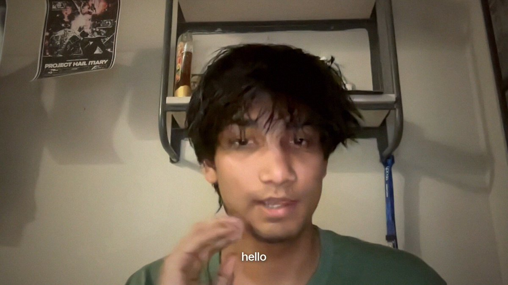

# Drewy — the canvas that draws back

An Android AI whiteboard buddy. Draw, talk, or **snap a question with the camera** — Drewy (a fluffy cloud) answers by *drawing* on your canvas: real photos, hand-drawn diagrams, charts, worked solutions, lessons that sketch themselves while it narrates, and live 3D models you can spin and explode.

## Demo

[](https://x.com/Shrit1401/status/2118972385818993022)

> made a buddy which will draw on ur phone. this weekend, i wanted to build something to help me out in my exams. it can make 3d models in realtime, also is weirdly good in physics
>
> — [@Shrit1401 on X](https://x.com/Shrit1401/status/2118972385818993022) · ▶ click the image to watch the video

```
drewy/
├── backend/   Node server — holds the OpenAI key, runs the brain
└── android/   Kotlin + Jetpack Compose app
```

## The brain

| Step | API | Model | Job |
|---|---|---|---|
| 1. Route | **Decisions API** | `gpt-6-luna` | Fast classifier: which visual fits (photo / diagram / chart / lesson / 3D / math), does it need live web facts, how hard is it |
| 2. Draw | **Responses API** | **Sol** `gpt-6.1-sol` | Writes the board by calling the `render_board` function. Web search is switched on only when the router says so; reasoning effort follows the router's difficulty score |

Design system (colours, type, components, mascot, motion): see [DESIGN.md](DESIGN.md).

Photos come from Wikipedia (no key). The board format is in `backend/board-schema.mjs` and mirrored in `android/.../data/Board.kt`.

## Run it

**1. Backend** (on your laptop)

```bash
cd backend
npm install
cp .env.example .env        # put your OPENAI_API_KEY in .env
npm start                   # http://0.0.0.0:8787
npm test                    # end-to-end smoke test of every mode (needs the server running)
```

**2. App**

```bash
cd android
./gradlew assembleDebug     # APK: app/build/outputs/apk/debug/app-debug.apk
./gradlew testDebugUnitTest # unit tests (board parsing, ink, shape snapping)
adb install -r app/build/outputs/apk/debug/app-debug.apk
```

On a **real phone**, the phone must reach your laptop: same Wi-Fi, then in the app tap the ✦ button (top-left on Home) → enter `http://<your-laptop-ip>:8787` → **Test**. (Find the IP with `ipconfig getifaddr en0`.) The emulator uses `http://10.0.2.2:8787` automatically.

## What's in the app

- **Home** — animated Drewy (Idle / Listening / Thinking / Happy), hold-to-talk, mode chips, Snap a question, recent canvases.
- **Canvas** — infinite paper: pen, highlighter, eraser, shapes (auto-snaps lines / boxes / ellipses), lasso, pan; two-finger pan + pinch zoom; undo; autosave.
- **Ask** — voice or text, in Ask / Teach me / 3D mode. Drewy sees the ink on screen. Answers play step by step: handwriting with a pen cursor, sketches drawn stroke by stroke, charts growing, narration spoken aloud. Follow-up chips.
- **Lasso** — circle your drawing → Clean it up / Make it 3D / Explain this / Find the real thing.
- **Snap a question** — camera (or gallery) → **Solve** (step-by-step with a *why* on each line), **Explain** (teaches the idea), **Check my work** (marks each handwritten line ✓/✗, points at the mistake, never just dumps the answer).
- **3D** — a built-in realtime renderer (no heavy engine): drag to orbit, pinch to zoom, tap a part, Cutaway + Explode sliders, ask about a part.
